# Tjommie

Tjommie is a free, open-source Windows app for AI agents that chat with you, work on your PC, talk to each other and run routines.
The agents run on your own computer through the official Claude Code and Codex command-line tools, signed in with your own accounts.

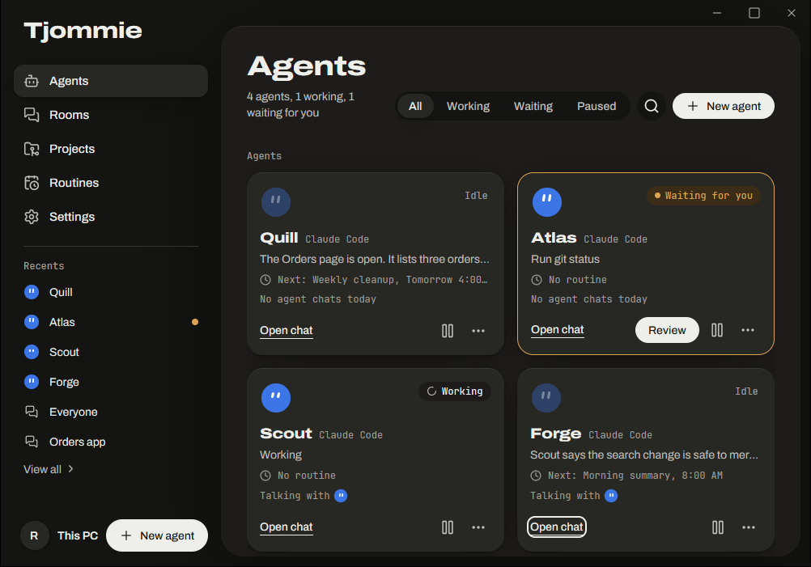

**[Download Tjommie](https://github.com/tsnyders/tjommie/releases/latest)**: a Windows installer and an Android app.

## How it works

### 1. Install

Download `Tjommie-Setup-<version>.exe` and run it. It installs for your Windows user only, needs no administrator rights, and starts Tjommie when it finishes.
Windows SmartScreen may warn about an unknown publisher, because the installer isn't signed yet: click **More info**, then **Run anyway**.
Your agents, chats and settings are kept in `%LOCALAPPDATA%\Tjommie`. Uninstalling leaves them there.

| Windows asks once | Choose Run anyway |
|---|---|
|  |  |

### 2. Sign in

Tjommie runs your agents with Claude Code and Codex, so install at least one of them first: Claude Code from [claude.com/claude-code](https://claude.com/claude-code), or Codex with `npm install -g @openai/codex`.
The first screen has a card for each. Click **Sign in to Claude** or **Sign in to Codex**. Your browser opens the provider's sign-in page, and Tjommie notices when you are done.
Tjommie keeps its own sign-in, separate from how you use these tools yourself, and never sees your password.
Codex agents that work in their own folder need Codex's sandbox. The Codex card offers **Set up Codex's sandbox**, and Windows asks for administrator permission once.

| Signed out | Signed in |
|---|---|
|  | 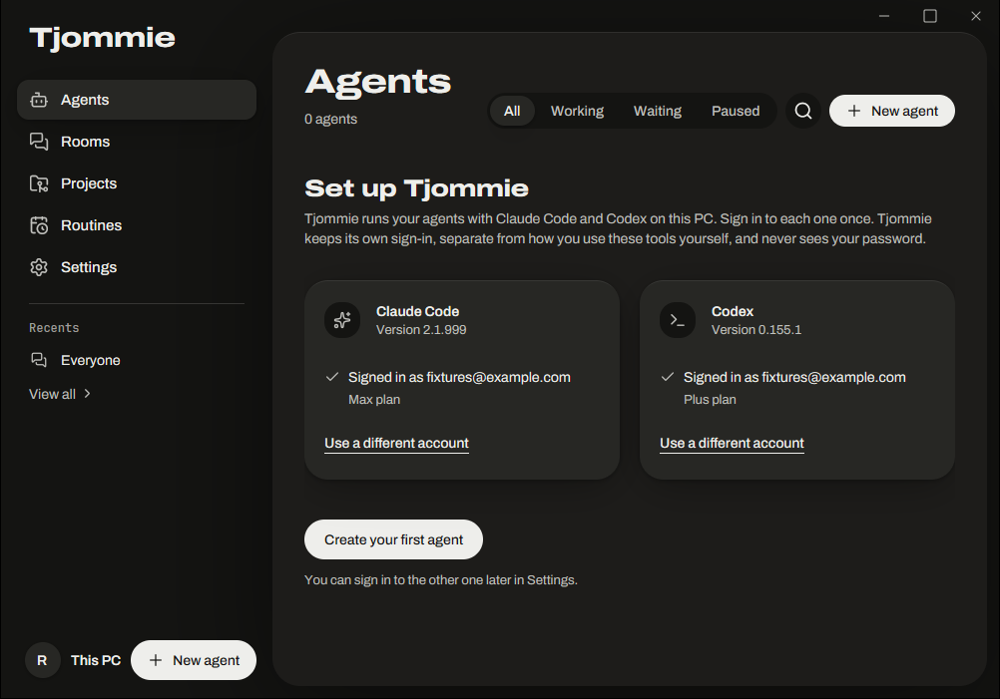 |

### 3. Create your first agent

Click **Create your first agent**, or **New agent** in the sidebar. Give the agent a name, a colour and a shape, and say what it should do.
Then choose its account and model, its folder, how much it may do without asking (see Autonomy levels below), and whether it gets a browser.

| New agent | Your agents |
|---|---|
| 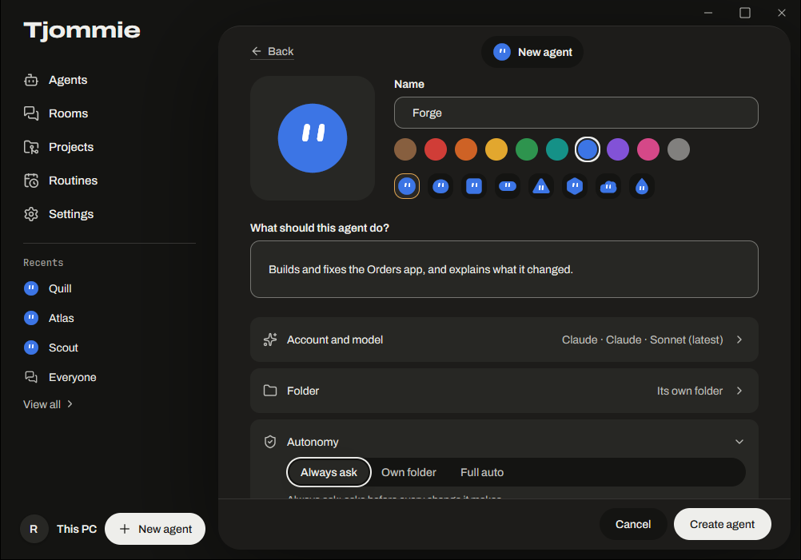 |  |

### 4. Chat and approvals

Open an agent and type. **Enter** sends and **Shift+Enter** starts a new line. The row under the box attaches files, mentions another agent, shows the agent's model (a menu changes it), dictates and sends.
If the agent is busy, your message steers it or waits in a queue. With the box empty, the round button stops the turn.

When an agent wants to do something it isn't allowed to do on its own, an approval card appears in the chat. It shows what the agent wants and the exact command.
**Approve** allows it once, **Deny** refuses, and **Always allow** saves a rule for that agent when the request names one.

Files an agent shares show up as cards. Click one to preview an image, a Markdown file, a PDF, or audio or video. **Download** saves it where you choose.

| A conversation | An approval |
|---|---|
| 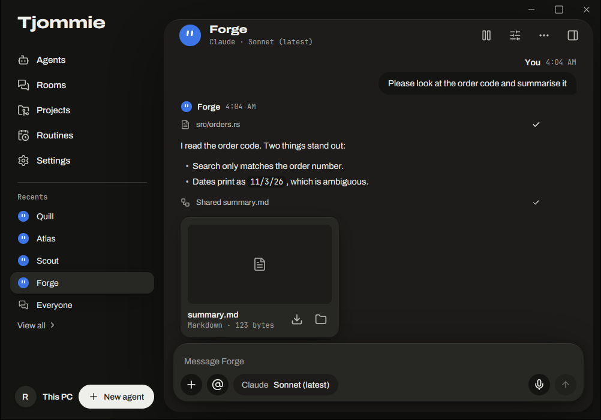 | 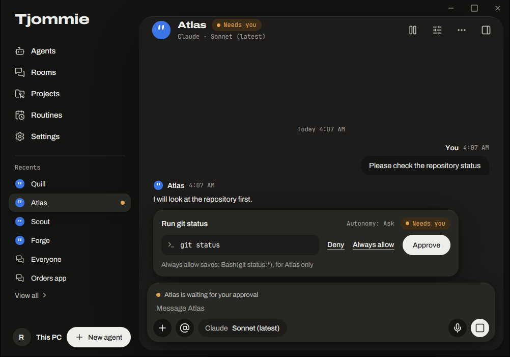 |

### 5. Team rooms and exchanges

The **Everyone** room holds every agent. **New room** makes a room with the agents you pick. Mention an agent by name in a room to hand it work.
An **exchange** is one agent asking another. Open it to see who asked whom and read the whole thing. Its box replies in Everyone with both agents mentioned.
Settings, then Agents, sets how many requests agents may pass between each other in one chain.

| Everyone | An exchange |
|---|---|
| 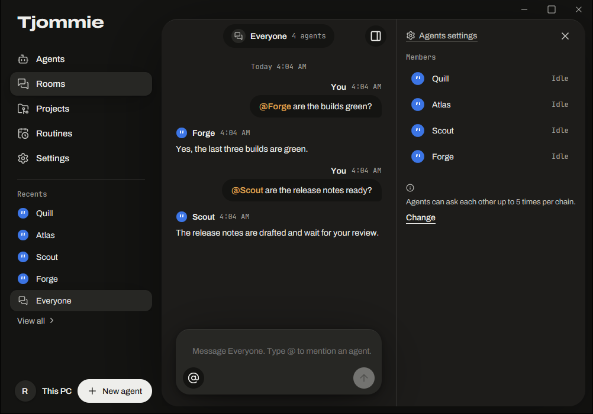 | 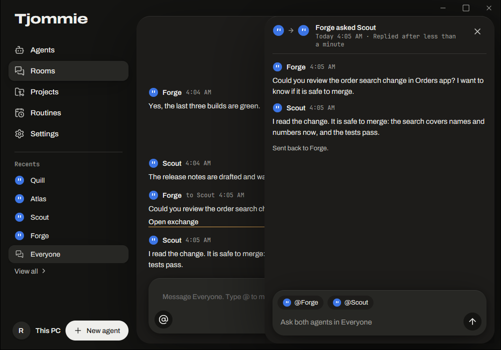 |

### 6. Routines

A routine is a prompt an agent runs on a schedule. **Routines** in the sidebar lists every agent's routines, and **Add routine** makes a new one.
A routine has a name, what to do, the days and times, the time zone those times are read in, and a **Stop after** limit. The editor lists the routine's recent runs.
If a routine fails, Tjommie shows a notification.

| Routines | The routine editor |
|---|---|
| 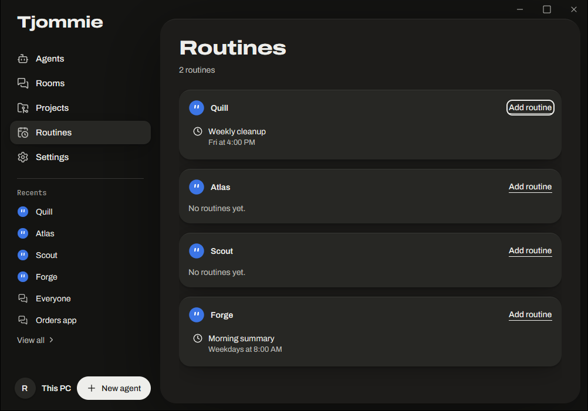 | 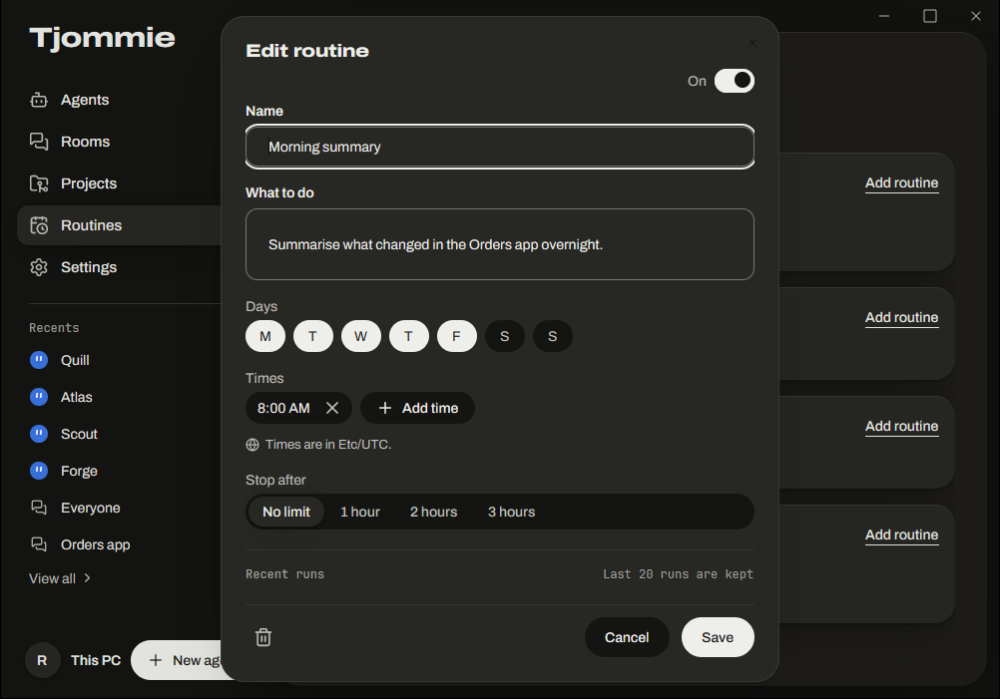 |

### 7. The agent's browser and Logins

Turn on **Browser** in an agent's settings. Then open the panel beside its chat with the panel button, **Ctrl+B**, or **Open browser** in the chat's More menu.
The browser is built into Tjommie and uses Microsoft Edge WebView2. You and the agent share the same tabs, and each agent keeps its own browser profile.
Click **Take control** before you type or click, and **Return to agent** to hand the page back. Google may block sign-in in automated browsers, and Tjommie says so in the panel.

The key button beside the address opens the logins menu: **Fill a saved login**, **Saved logins** and **Manage logins**.
Settings, then Logins, lists the logins saved on the PC that runs your agents. A new login is typed into a separate Logins window, and its username and password never appear in the main window or in a chat.
Before it fills anything, Tjommie confirms the exact HTTPS site.

| The browser panel | The logins menu |
|---|---|
| 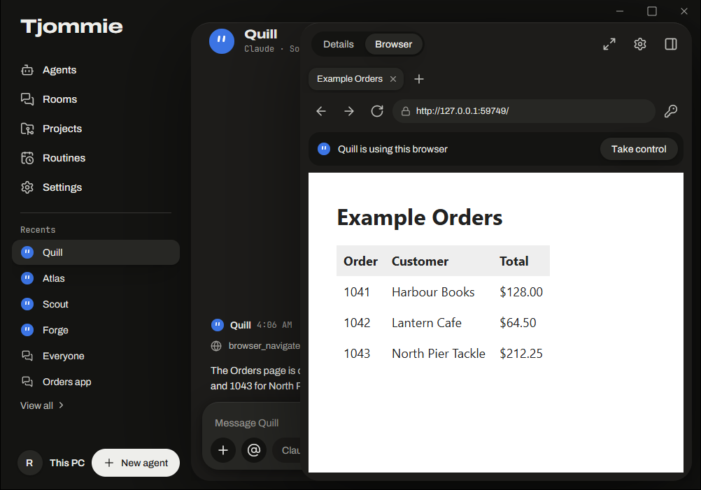 | 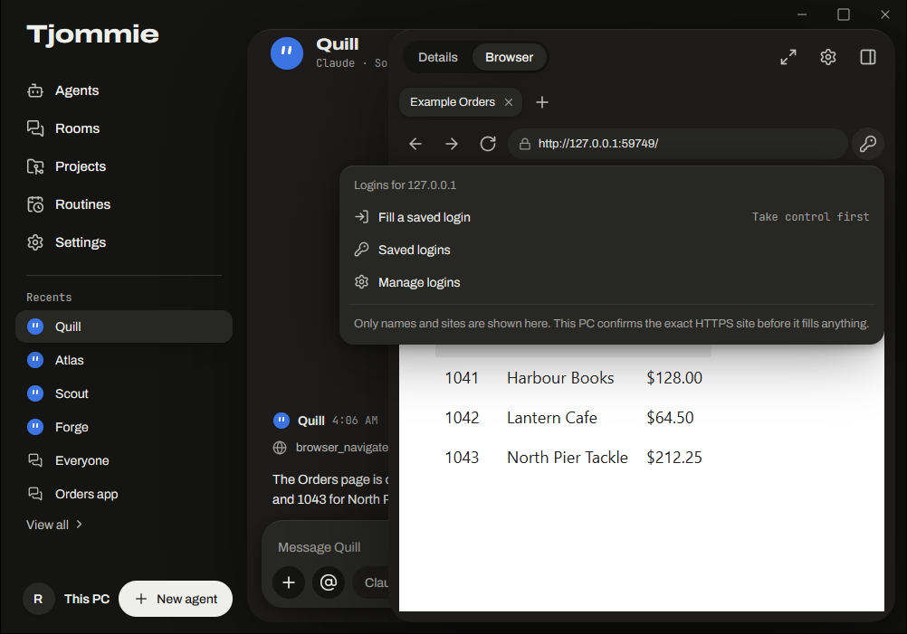 |

### 8. Pair the Android companion

Install the Android app from the same release page. On the PC, open Settings, then Devices, then **Pair a device**, and scan the code in the Android app or paste it there.
A code works once and lasts ten minutes. Pairing works on the same Wi-Fi as the PC, or over mobile data when the relay is on. The PC has to be awake.
Every paired device has full owner authority. Revoke a lost phone from the same Devices screen.
See [`packages/mobile/README.md`](packages/mobile/README.md) for signing and build details.

| Devices | Pair a device |
|---|---|
| 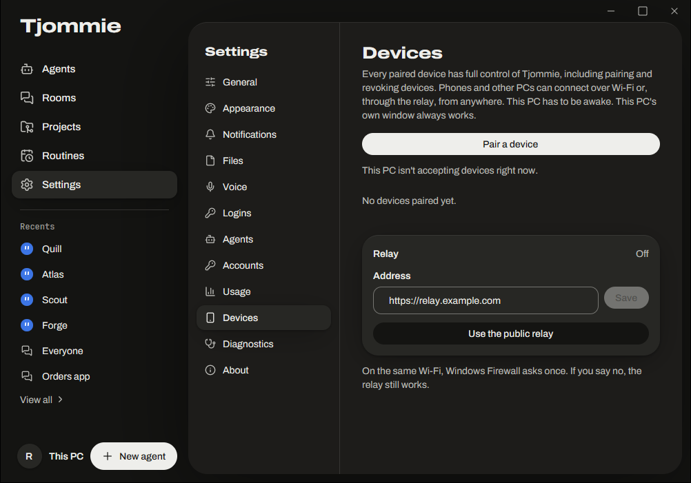 | 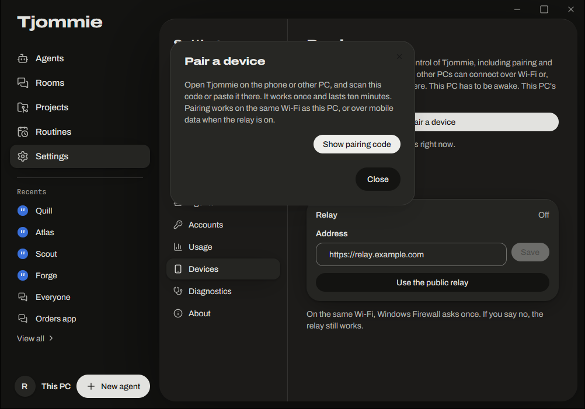 |

## Features

| Accounts and spending caps | Usage | Light theme |
|---|---|---|
| 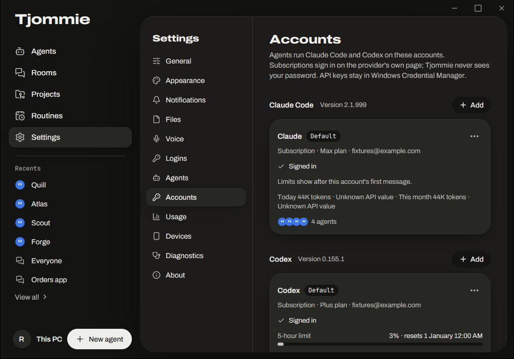 | 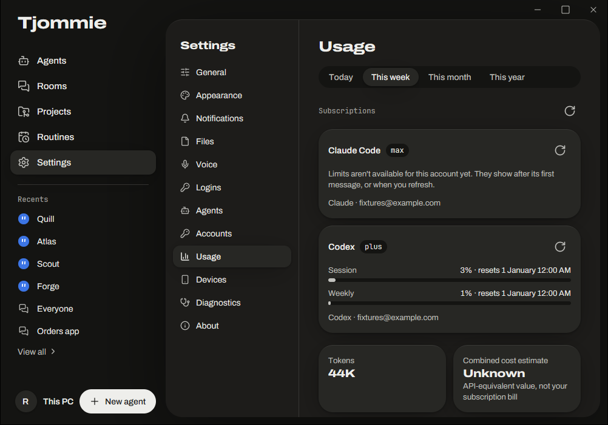 | 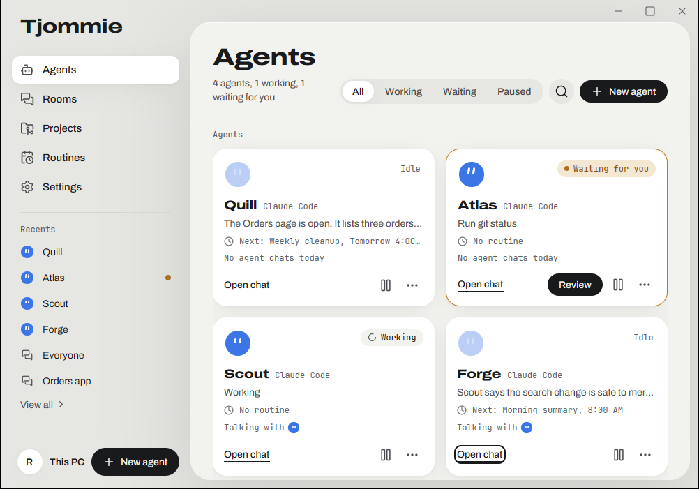 |

- **Accounts and usage**: Settings, then Accounts, holds your Claude Code and Codex accounts, each a subscription or an API key. Settings, then Usage, shows tokens and cost for today, this week, this month and this year, by agent, account or model.
- **Spending caps**: An API-key account has a spending cap in dollars. Agents stop using the key once its total spend reaches the cap. The figure is an estimate from the prices Tjommie knows, not an invoice, so your provider's bill may be higher.
- **Autonomy levels**: Each agent is set to **Always ask**, **Own folder** or **Full auto**. Always ask checks with you before every change. Own folder lets the agent work freely in its own folder and asks before anything else. Full auto never asks, and Tjommie asks you to confirm before it turns it on.
- **The tray**: Closing the window keeps Tjommie running in the Windows tray. Left-click the icon to show the window. Right-click for **Open Tjommie**, **Restart to update** (when an update is ready) and **Quit Tjommie**.
- **Notifications**: Tjommie shows a Windows notification when an agent needs approval, finishes, fails or hits a usage limit, and when a routine fails. It stays quiet while its window is in front. Clicking a notification opens that chat or room.
- **Start at sign-in**: Tjommie starts hidden in the tray when you sign in to Windows. Turn it off in Settings, then General.
- **Automatic updates**: Tjommie checks GitHub Releases a minute after it starts and then every six hours. It downloads an update in the background and installs it when you quit. It checks each download against the checksum in the release before it runs it. **Check now** and **Restart** in Settings, then General, do it on demand.
- **Keyboard-only use**: Tab and Shift+Tab move between controls, the arrow keys move inside lists and groups of choices, and Enter or Space presses a button.
- **Light and dark**: Tjommie opens in dark. Settings, then Appearance, offers Dark, Light or System, larger text, and compact spacing.

## Use

- Closing the window keeps Tjommie in the tray, so agents and routines keep working. To stop Tjommie, choose **Quit Tjommie** in the tray menu.
- **Ctrl+B** opens or closes the browser panel. **Escape** closes it, unless a dialog or menu is open: then Escape closes that first.
- **Ctrl+=** and **Ctrl++** zoom in, **Ctrl+-** zooms out, and **Ctrl+0** goes back to 100%. These work while a page in the agent's browser has the keyboard.
- **Enter** sends a message and **Shift+Enter** starts a new line. **Ctrl+Enter** approves in a focused approval card.
- In the mention list, **Up** and **Down** move, **Tab** or **Enter** picks, and **Escape** closes the list.

## Build

See [`docs/DEVELOPMENT.md`](docs/DEVELOPMENT.md) for building, running from source and the tests.

## License

[Apache-2.0](LICENSE). Tjommie is an independent project, not affiliated with the makers of Grok Bot, Claude Code or Codex.
